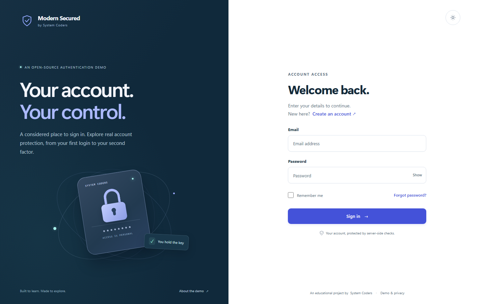
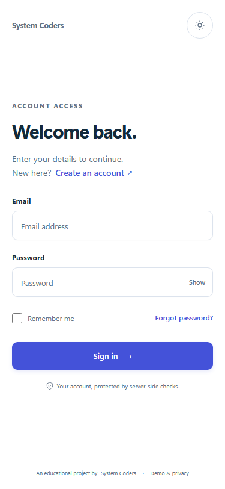
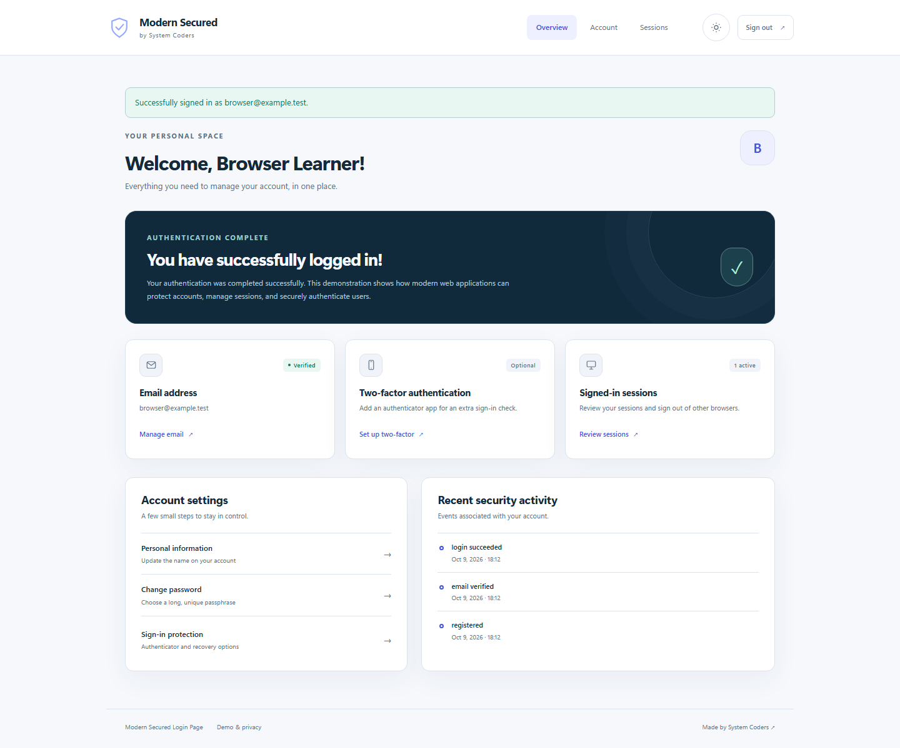

# Modern Secured Login Page

A working authentication reference application by [System Coders](https://systemcoders.net). Learn registration, verified email, password recovery, optional authenticator MFA, and session revocation through real Django routes and server-side checks.

This is a standalone educational project. It does not connect to InfoBusiness, customer installations, payment providers, or production databases. Verification evidence and remaining limits are recorded in [docs/verification.md](docs/verification.md).

## Features

- Email and password registration, mandatory email verification, login, logout, and bounded remember-me sessions.
- Password reset with an expiring Django token, fresh login afterward, and revocation of existing sessions.
- Optional TOTP with QR/manual enrollment and single-use, hashed recovery codes.
- Profile settings, fresh authentication for security changes, active sessions, and revocation of other devices.
- Argon2id password hashing, CSRF protection, restrictive CSP, server-side rate limits, security events, and generic recovery responses.
- Responsive Django templates, light/dark themes, keyboard focus, reduced motion, and no external frontend assets.
- SQLite locally; environment-configured PostgreSQL and shared Redis in production.

## Screenshots







Screenshots use synthetic accounts only. Browser verification details, including tested widths and limits, belong in [the verification record](docs/verification.md).

## Stack and layout

Python 3.13, Django 5.2 LTS, django-allauth, argon2-cffi, cryptography/Fernet, WhiteNoise, and minimal CSS/JavaScript. Hash-locked dependencies are in `requirements.txt` and `requirements-dev.txt`; their `.in` files express direct dependency policy.

```text
accounts/          User model, adapters, MFA, recovery codes, encrypted sessions
accounts/migrations/  Version-controlled database schema
config/            Settings, routing, WSGI, middleware
templates/         Authentication, settings, dashboard, errors, email
static/            Local CSS, JavaScript, icons
tests/             Business/security and browser regression suites
scripts/           Safe repository checks
docs/              Architecture, testing, operations, deployment, decisions
.github/           CI, dependency updates, contribution templates
```

## Run locally

Install an official Python 3.13 distribution. In PowerShell, from the project directory:

```powershell
py -3.13 -m venv .venv
.\.venv\Scripts\python.exe -m pip install --require-hashes -r requirements-dev.txt
Copy-Item .env.example .env
.\.venv\Scripts\python.exe manage.py migrate
.\.venv\Scripts\python.exe manage.py collectstatic --noinput
.\.venv\Scripts\python.exe manage.py runserver 127.0.0.1:8000
```

On Linux/macOS replace `py -3.13` with `python3.13` and `.\.venv\Scripts\python.exe` with `.venv/bin/python`. Visit [http://127.0.0.1:8000/accounts/login/](http://127.0.0.1:8000/accounts/login/). Development configuration generates and persists local keys in ignored `.local/secrets.json`; SQLite and outgoing email files also stay under `.local/`. Keep this directory private. A copied `.env` is supported, and process environment variables take precedence.

No default administrator or shared demo credentials are created. Register a synthetic name/email and a passphrase of at least 15 characters. Before the protected welcome page opens, verify the address using the link in the latest `.local/emails/` message. Email files contain active links: open them locally, and never attach or commit them.

Debug tracebacks are off by default, including locally. WhiteNoise serves the collected assets, so rerun `collectstatic` after editing static files. Enable `DJANGO_DEBUG=1` only for isolated debugging with synthetic data; an enrollment error page can otherwise reveal sensitive local variables.

## Try account recovery and MFA

1. Select **Forgot password?**, submit the registered email, and open the reset link in `.local/emails/`. Unknown addresses receive the same public confirmation. Links expire after 30 minutes by default.
2. Set a new valid passphrase. The reset requires a fresh login, invalidates the used link and existing authenticated sessions, and preserves MFA enrollment.
3. In account security settings, enable authenticator MFA. Scan the QR code with an authenticator app or enter the manual key, then submit a current code to finish enrollment.
4. Save recovery codes in a password manager. Each code works once. Regenerating them invalidates the previous set; displayed codes cannot be retrieved later.
5. Sign in from another browser context, review the session page, and revoke the other sessions. Check that the other context loses access.

MFA is optional for this educational app. If an account loses both its authenticator and all recovery codes, there is no support bypass or SMS fallback. See [SECURITY.md](SECURITY.md) before adapting this design.

## Verify changes

```powershell
.\.venv\Scripts\python.exe manage.py check
.\.venv\Scripts\python.exe manage.py makemigrations --check --dry-run
$env:SKIP_BROWSER_TESTS = '1'
.\.venv\Scripts\python.exe manage.py test tests
.\.venv\Scripts\python.exe -m ruff check .
.\.venv\Scripts\python.exe -m ruff format --check .
.\.venv\Scripts\python.exe -m bandit -r accounts config -x accounts/migrations
.\.venv\Scripts\python.exe -m pip_audit -r requirements.txt --no-deps --disable-pip
.\.venv\Scripts\python.exe scripts/check_secrets.py
.\.venv\Scripts\python.exe -m playwright install chromium
$env:SKIP_BROWSER_TESTS = '0'
.\.venv\Scripts\python.exe manage.py test tests.test_browser
```

Chromium is a development test dependency. Its installer downloads a browser; it is not needed to run the app. Read [docs/testing.md](docs/testing.md) for test isolation, PostgreSQL checks, and interpretation of skipped checks. The [first hosted CI run](https://github.com/systemcoders-gh/modern-secured-login-page/actions/runs/37972878363) passed SQLite, PostgreSQL/Redis, browser, static/security, and container build checks. Exact counts and remaining limits are recorded in [docs/verification.md](docs/verification.md); real SMTP delivery and production hosting remain unqualified.

## What the protections do

Authentication proves who is signed in; authorization decides what that identity may access. This app requires a verified, authenticated account before showing protected content, and checks ownership again when changing a profile or revoking a session.

Password hashes slow offline guessing; they do not make weak passwords safe. CSRF tokens protect browser state changes. Secure cookies and HTTPS protect transport. TOTP adds a second factor. Single-use recovery codes provide a controlled backup. Rate limits reduce automated abuse and require shared Redis across production workers. Encrypted session data and MFA secrets limit disclosure from a database-only compromise; the deployment's encryption keys must be stored separately from its database backups.

## Deployment and limits

See [docs/deployment.md](docs/deployment.md), [docs/operations.md](docs/operations.md), and [docs/architecture.md](docs/architecture.md). Production startup rejects missing required configuration. Supply a real HTTPS origin, explicit hosts, PostgreSQL, shared Redis, SMTP, and separate strong application/encryption keys. Do not use Django's development server for internet traffic.

This project is not a certification of production security or WCAG compliance. Provider delivery, TLS/proxy behavior, managed backups/restores, capacity, monitoring, and independent review must be validated in the chosen environment. No external breached-password service or social login is configured. SMTP is synchronous; deliverability and timing behavior require staging measurement.

## Contribute and publish

Read [CONTRIBUTING.md](CONTRIBUTING.md), [SECURITY.md](SECURITY.md), and [AGENTS.md](AGENTS.md). The repository is [systemcoders-gh/modern-secured-login-page](https://github.com/systemcoders-gh/modern-secured-login-page), currently private. Public visibility requires the owner's explicit final approval after reviewing code, history, secrets, tests, and CI. [docs/deployment.md](docs/deployment.md#private-github-preparation) includes owner commands for future source synchronization.

Licensed under [MIT](LICENSE). Copyright 2026 System Coders.
