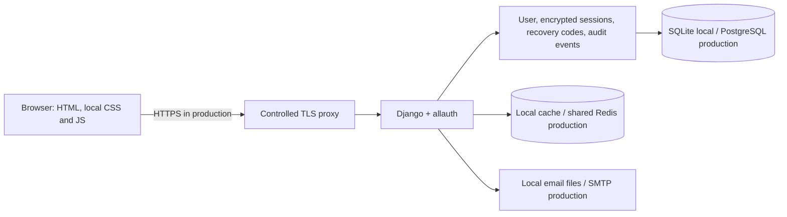

# Architecture

## Repository discovery

The implementation target is the `secured login` directory supplied for Modern Secured Login Page. The initial inspection found no application or Git repository there. The attached specification explicitly selected Python/Django and a new independent authentication demonstration. No InfoBusiness repository, POS module, client database, license service, payment integration, or production installation was inspected or changed. Those systems are outside this application's scope.

## Application structure

`config` defines settings, middleware, URLs, and WSGI. `accounts` owns the custom email-based user model, account/security behavior, allauth adapters, encryption, recovery codes, and session handling. `accounts/migrations` records schema changes. `templates` and `static` provide the frontend; there is no Node package manager or frontend build pipeline. `tests` and `.github/workflows/ci.yml` provide regression/quality checks. Exact test evidence is in [verification.md](verification.md).

The app uses Django's ORM and version-controlled migrations. The custom user model is created before the first application migration. Email normalization and database uniqueness protect the identity invariant, including concurrent registration. Recovery-code consumption must remain atomic. Production PostgreSQL is a deployment requirement; SQLite is a local learning default.

## Authentication and authorization

django-allauth supplies registration, verification, login, logout, password change/reset, reauthentication, and TOTP stages. Django supplies password hashing, CSRF, ORM, escaping, and server-side sessions. The application's custom logic extends these flows rather than creating another authentication endpoint.

Protected routes require a verified authenticated account. MFA-enrolled users must complete the second-factor stage; a password-only partial login is not a session with protected-page access. Profile/session updates scope queries to the authenticated owner. Sensitive settings require recent authentication. There is no administrative login route or account-recovery override.

Password recovery uses Django's established token mechanism with a default 1,800-second lifetime and effective single-use behavior through password-state changes. URLs use a validated configured application origin. A successful reset revokes sessions, preserves MFA, and requires a fresh login. Public recovery responses do not identify registered addresses. Production SMTP behavior and timing must still be measured.

TOTP secrets and database session payloads are encrypted with Fernet using keys stored outside the database. Fernet is authenticated encryption provided by `cryptography`, not a custom cipher. Recovery codes are random values containing 128 bits of entropy, stored as hashes; successful consumption invalidates the code. Encryption does not protect against an attacker who controls the running server and its keys.

## Routes and frontend

| Route | Purpose | Access |
| --- | --- | --- |
| `/accounts/` | Allauth registration, login, email, password, reauthentication, MFA | Depends on the authentication stage |
| `/` | Welcome dashboard | Verified, fully authenticated account |
| `/settings/` | Profile and security entry point | Verified account; sensitive actions require fresh authentication |
| `/sessions/` | View and revoke owned sessions | Verified account, with fresh authentication for revocation |
| `/security/recovery-codes/` | Generate replacement MFA recovery codes | Verified MFA account with fresh authentication |
| `/about/` | Public educational explanation | Public |
| `/health/` | Minimal database/shared-cache health response | Public, no configuration/secret details |

Forms are semantic Django templates with CSRF tokens. Theme preference is cosmetic; it never controls authentication. Static assets are collected and served with WhiteNoise; debug tracebacks are off even locally. CSP restricts resource origins, `strict-origin` referrer policy excludes token-bearing paths while preserving the origin for browser POST/CSRF behavior, and frame restrictions prevent embedding. No external analytics/font/script provider receives recovery-page traffic.

## Integrations, jobs, storage, and tenancy

Email is the only outbound application integration. Development writes mail files in ignored `.local/emails`; production requires configured SMTP. Redis shares rate-limit state across production workers. No email queue, cron registration, payment processor, webhooks, SMS/WhatsApp, social login, public JSON API, or upload feature is configured. An API and upload subsystem are not implied by the architecture.

All users are scoped identities within one installation. This is not an InfoBusiness tenant architecture. Separate installations would require independent databases, encryption/application keys, origins, cache namespaces, SMTP configuration, backups, and deployment permissions. Account isolation tests within one database do not prove separate-client deployment isolation.

## Configuration, logging, and operations

Configuration comes from environment variables and an ignored optional `.env`. Development keys persist in `.local/secrets.json`; production requires explicit secrets, HTTPS origin/hosts, PostgreSQL, Redis, and SMTP and must fail closed when these are absent. [deployment.md](deployment.md) lists the variables without secret values.

Security events are stored with minimal details; they must never include credentials, tokens, codes, session identifiers, or raw authenticator material. Application and reverse-proxy access logs need a policy that excludes token-bearing URLs and query strings. Error handling must avoid debug traces in production. [operations.md](operations.md) covers logging, retention, incident response, and backup/restore.

Performance constraints are mostly intentional Argon2 CPU cost, synchronous SMTP latency, and database/session writes. There is no measured production capacity claim. Redis protects distributed throttling; it is not a substitute for ingress abuse protection. Changes to hasher cost, indexes, session persistence, or SMTP execution require measured regression/capacity evidence.
